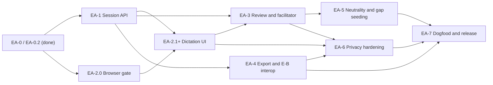

# Implementation Plan: Intent Elicitation Track — E-A (Conversational Elicitation & Transcription)

> **Audience:** an orchestrator that hands work packages EA-1 … EA-7 to implementation and verification agents in this repository.
> **Execution scope right now:** EA-1 onward is authorised. EA-0 / EA-0.2 are complete and approved (2026-10-24). EA-2 opens with a blocking in-browser gate (EA-2.0) that can run in parallel with EA-1.
> **Status:** Design decisions D-EA-1 … D-EA-5 accepted (architecture decisions D-130 … D-134, constraint C-28). Implementation decisions D-EA-6 … D-EA-17 resolved with the user on 2026-10-24 (§4.3). Implementation of EA-1+ not yet started.

---

## 1. Problem Statement

E-B provides deterministic rails for extracting grounded goals and open questions from transcripts and vision documents. It does not help a stakeholder produce a useful transcript in the first place. Initial intent is often spoken, incomplete, tentative, and discovered through conversation. Requiring users to prepare a transcript manually creates friction and can lose the clarifications that emerge while exploring a problem.

E-A is the upstream conversation and transcription experience. It should help a stakeholder articulate their own intent, preserve uncertainty and corrections, establish scope boundaries, and emit a reviewable transcript that E-B can ingest without special-case parsing.

The experience must not turn TKS into an LLM host, send speech to a cloud service, silently rewrite a stakeholder's words, or store microphone audio.

## 2. Scope and Relationship to E-B

E-A is the conversational intake half of the Intent Elicitation Track. Its only durable output is an ordinary `tks-transcript/v1` Markdown document. Audio is never stored or transmitted across any network interface.

```text
 [stakeholder] ──speaks/types──▶ [Chromium browser: /explorer/elicitation]
                                      │
                 ┌────────────────────┴─────────────────────┐
                 ▼                                          ▼
       Sherpa-ONNX streaming ASR                    draft box: review / edit
       (WASM in a WebWorker)                        (stakeholder-controlled)
                 │                                          │
                 └────────────────────┬─────────────────────┘
                                      │ UTF-8 JSON turn (HTTP), SSE back
                                      ▼
                                 [tks serve]  in-memory draft session store
                                      │
                                      ├──HTTP──▶ Ollama /api/chat (optional, explicitly configured)
                                      ▼
                     tks-transcript/v1 Markdown (browser download)
                                      │
                                      ▼
              E-B via the user's agent: open_extraction_session(doc_path) → … → get_gap_report
                                      │
                                      └── gap questions (DetectedGap) ──▶ next E-A cycle
```

E-A covers browser-based conversation capture, client-side streaming transcription, turn review, optional facilitator question generation, and export. E-B continues to own transcript ingestion, goal extraction, entailment checks, gap detection, and goal staging. E-A does not create or stage `GOAL` graph nodes and does not call E-B MCP tools on the user's behalf.

**Out of scope for E-A v1:** MCP sampling (deferred; §4.3 D-EA-6), multiple stakeholders per session, non-English speech recognition, Safari support, server-side file writes of transcripts, per-turn provenance, ServiceWorker/offline-app packaging, and audio of any kind on the server.

### 2.1 Glossary (avoid identifier confusion)

| Term | Meaning | Format |
| ---- | ------- | ------ |
| `elicitation_id` | Server-generated identifier of a live E-A draft session in `tks serve` memory. Never exported. | UUID v4 |
| `session_id` | Transcript frontmatter field; stable across cycles (D-134). | Slug `^[A-Za-z0-9][A-Za-z0-9_-]{0,63}$` |
| `cycle` | Transcript frontmatter iteration number. | Integer ≥ 1 |
| `extraction_session_id` | E-B extraction session (`ingestion_jobs.job_id`) returned by `open_extraction_session`. Used only to import gap questions. | UUID |
| Turn number | `N` in `tN`; assigned contiguously by the server at commit time. | Integer ≥ 1 |
| Proposal | An uncommitted facilitator question generated by Ollama, awaiting accept / edit / reject. | `proposal_id` UUID |

## 3. Governing Principles

1. **Bring your own cognition.** Follow D-124, C-25 and C-27: no LLM SDK and no in-process model inference of any kind (LLM or ASR) in TKS. Facilitator questions may come from a local Ollama service reached over its HTTP API, only when explicitly configured (D-EA-6).
2. **Speech recognition is client-side only.** ASR runs entirely in the browser (Sherpa-ONNX WASM, D-131). `tks serve` only serves static engine/model files and exposes no audio endpoint (C-28).
3. **No audio storage or transmission.** Microphone audio exists only in bounded volatile browser memory long enough to be transcribed, then is dropped. It is never transmitted across any network interface (including loopback) and never written to disk, database, logs, browser storage (`IndexedDB`, `localStorage`, `CacheStorage`), or exports (D-132, C-28). There is no opt-in exception.
4. **Stakeholder agency.** The stakeholder controls when to record, stop, edit, submit, accept or reject facilitator questions, close, export, or discard. The facilitator asks neutral questions and must not invent requirements.
5. **Visible provenance.** Transcript-level `source` only (`manual` or `asr`, D-EA-7). No per-turn provenance fields (D-133). Human-reviewed text is authoritative; never silently replace a stakeholder's words.
6. **E-B-compatible output.** Export only transcripts accepted by `ParsedTranscript::parse` and the exporter's own frontmatter checks (§6.5). Preserve `session_id` and increment `cycle` when continuing (D-134).
7. **Graceful degradation.** Typed entry for both stakeholder and facilitator turns always works when the microphone, ASR assets, WASM SIMD, or Ollama are unavailable.

## 4. Decisions

### 4.1 Constraints Already Established

| Constraint | Source | Implication for E-A |
| --------- | ------ | ------------------- |
| LLM cognition is external to `tks serve`; optional Ollama offload only. | D-124 / C-25 / C-27 (clarified in EA-1, D-EA-6) | Facilitator generation is an optional HTTP call to Ollama, off by default; no SDK; no core function depends on it. |
| Track placement and names are E-A and E-B, before Phase 5. | D-126 | Do not renumber Phase 4 or fold E-A into E-B. |
| Transcript output is `tks-transcript/v1`. | D-128 and [transcript specification](../vision/elicitation-transcript-format.md) | E-A must satisfy the normative frontmatter and turn rules. |
| E-B supplies grounded gap questions for a later cycle. | [E-B plan](./intent-elicitation-eb-plan.md), `DetectedGap` in `src/ingest/elicitation.rs` | E-A imports `DetectedGap.suggested_question` values as facilitator context, never as stakeholder statements. |

### 4.2 Accepted Architecture Decisions

These are recorded as **D-130 … D-134** and **C-28** in [architecture.md](../vision/architecture.md). They are not reopened unless a decision's "Reopen If" condition is met.

| Plan ID | ADR ID | Decision | Status of evidence |
| ------- | ------ | -------- | ------------------ |
| D-EA-1 | D-130 | Socratic cognition sits behind a small conversation-provider boundary. EA-0 proved **out-of-process Ollama** and **typed/manual**; **MCP sampling is not viable** (no server→client requests in TKS's MCP transport; only VS Code advertises sampling). | Done (EA-0). MCP sampling deferred as a D-130 follow-up. |
| D-EA-2 | D-131 | Client-side Sherpa-ONNX streaming Zipformer (`k2-fsa/sherpa-onnx-streaming-zipformer-en-2023-06-26`, Apache-2.0, 67.6 MB INT8) via WebAssembly. Fallback: Transformers.js / Whisper-tiny.en (MIT, 39 MB). | Accuracy, footprint and silence behaviour proven in **Node.js** (EA-0.2). In-browser behaviour still unproven → EA-2.0 gate. |
| D-EA-3 | D-132 | Zero audio storage or network transmission. | Architecture proven; browser network audit pending (EA-2.0, EA-6). |
| D-EA-4 | D-133 | Human-reviewed utterance text is authoritative; ASR-derived transcripts declare `source: asr`. | Round-trip test in EA-4. |
| D-EA-5 | D-134 | Follow-up cycles keep `session_id`, increment `cycle`, and present imported E-B gap questions as prompts. | Cycle-2 test in EA-1 / EA-5. |

**ASR model selection rationale (D-131).** EA-0 benchmarked server-side batch models (Cohere Transcribe 2B, Whisper large-v3-turbo on candle; [`spike-ea0-results.md`](../vision/spike-ea0-results.md)). Accuracy was high, but they needed 9.4–14.4 GiB RAM and CUDA toolchains, could not share the 8 GiB GPU with `qwen3:8b`, and had 4.9–8.8 s end-of-utterance latency. On 2026-10-24 the user reopened D-131 ([`spike-ea0-streaming-proposal.md`](spike-ea0-streaming-proposal.md)). EA-0.2 benchmarked client-side streaming engines on the same 60-clip set ([`spike-ea0-2-results.md`](../vision/spike-ea0-2-results.md)), and the user approved Sherpa-ONNX Zipformer:

| Model / Framework | Licence | Architecture | Footprint | Streaming mechanism | Status |
| ----- | ------- | ------------ | --------- | ------------------- | ------ |
| **Sherpa-ONNX Web** (`k2-fsa`) | **Apache-2.0** | **Streaming Zipformer (INT8)** | **67.6 MB weights** | **Chunked streaming transducer** | **Selected** |
| Transformers.js / ORT Web | MIT | Quantised Whisper `tiny.en` | ~39 MB weights | Sliding-window / WebGPU chunked | Fallback (only if EA-2.0 fails) |
| whisper.cpp WASM | MIT | Quantised GGML Whisper `tiny.en` | ~75 MB weights | Sliding-window streaming | Not planned |

> [!WARNING]
> EA-0.2 numbers come from the Node.js harness (`scripts/spikes/ea0_streaming/run_benchmark.js`). The web prototype in `scripts/spikes/ea0_streaming/web/` **simulates** partial tokens; it uses no WASM, no worker, and no network audit. Zipformer disfluent-speech WER was **68.9%** (AMI cross-talk). EA-2.0 must prove in-browser behaviour on the user's own microphone before EA-2 continues.

### 4.3 Implementation Decisions Resolved 2026-10-24

| ID | Topic | Decision |
| -- | ----- | -------- |
| D-EA-6 | Facilitator provider | `tks serve` calls Ollama's native HTTP API (`POST {ollama_url}/api/chat`, `think: false`, `stream: false`) with the existing `reqwest` dependency. It does so **only when explicitly enabled** (`--facilitator ollama`; default `none`). No LLM SDK. MCP sampling is deferred. EA-1 clarifies D-124 / C-27 wording to match. |
| D-EA-7 | Provenance | No format change. `source: asr` if **any** committed turn was dictated (ASR text entered the draft before submission), otherwise `source: manual`. |
| D-EA-8 | Turn bounds | Remove the 15–40 turn bounds from `ParsedTranscript::parse` (the parser requires ≥ 1 turn, no maximum). The 15–40 rule stays only in the synthetic-corpus fixture test (`tests/elicitation_fixtures.rs`). The spec states explicitly that there are no turn-count bounds. A later stage may revisit limits. |
| D-EA-9 | Participants | Exactly one `stakeholder` and one `facilitator` participant per session. LLM-proposed and manually typed facilitator turns both use the single facilitator participant. The `agent` role is not emitted by E-A v1. |
| D-EA-10 | Browser access | Elicitation page and API are **unauthenticated, loopback-only**, like the Explorer. Mitigations (§6.2, §6.7): loopback `Host` allow-list, same-origin `Origin` check, no permissive CORS on elicitation routes, no session listing endpoint, unguessable `elicitation_id`. |
| D-EA-11 | Draft storage | In-memory store in `tks serve`; idle expiry 24 h (configurable). Survives browser reload; lost on server restart (UI warns). No database tables. |
| D-EA-12 | ASR assets | A pinned fetch script (version + SHA-256 lock file) downloads the Sherpa WASM engine and model into a local cache outside the repository. `tks serve` serves them from a configured directory. If missing, ASR is disabled and the UI is typed-only. Nothing large is committed or embedded in the binary. |
| D-EA-13 | Latency acceptance | Measured in Chromium on the reference machine (the EA-0 host). p95 frame-to-partial-render ≤ 500 ms and p95 release-to-final ≤ 500 ms. EA-0.2's "< 100 ms" is Node-only evidence. |
| D-EA-14 | Browsers | Chromium-based (Chrome/Edge, current stable) required. Firefox best-effort (must not break typed mode). Safari unsupported. |
| D-EA-15 | Uncertainty and corrections | Uncertain-span flags are UI metadata (stored in the draft session, never exported) and must be cleared before close/export. Retractions are new stakeholder turns. Editing committed turns is allowed (labelled "Correct transcription") while the session is open. No split/combine. |
| D-EA-16 | Spike cleanup | Remove the `asr-spike` Cargo feature, its optional dependencies, the `ea0_asr_spike` binary, and `scripts/spikes/ea0_asr/` in EA-1. Spike result documents remain the archive. |
| D-EA-17 | Export | Browser download only (`Content-Disposition: attachment`). `tks serve` never writes transcripts to the filesystem. The user saves the file and passes its path to their agent for E-B. |

## 5. User Journey

1. The user opens `http://localhost:<port>/explorer/elicitation`. They start a new session, or continue one by uploading the prior cycle's transcript. They can also supply an E-B `extraction_session_id` to import gap questions.
2. The user sets the title, `session_id` (new sessions only), stakeholder name, and facilitator name. The UI states that speech is transcribed locally in the browser and audio is never stored or sent.
3. If a facilitator provider is configured, the facilitator proposes an opening question. The user accepts, edits, or rejects it, or types their own. The facilitator asks one neutral, open question at a time about the problem, affected stakeholders, desired outcomes, constraints, examples, uncertainty, and explicit boundaries (what the solution is not).
4. The stakeholder holds `Ctrl+Alt+V` or the mic button to dictate. Live partial text streams into a preview. On release the text lands in the editable draft box, where the stakeholder corrects it and presses `Enter` to submit. Typing works throughout.
5. The user can correct the transcription of a committed turn, flag an uncertain span for later attention, or retract a statement by saying so in a new turn.
6. The user closes the session. The server validates the transcript and reports actionable errors (for example, uncleared uncertainty flags). The user downloads the `.md` file and gives its path to their agent for E-B. No audio exists to retain.

## 6. Work Packages

### 6.0 General Execution Rules (apply to every package)

- Read `.github/copilot-instructions.md` (`GEMINI.md` is a symlink to it), `.shared/ai/core/service-instructions.md`, and `.shared/ai/core/common-instructions.md` before implementation. Use `codegraph explore` before grep/find to inspect routes, state, and error envelopes.
- No LLM SDK, no in-process model inference, no audio processing libraries, and no audio endpoints in `tks serve` (C-25, C-28).
- Never persist microphone audio or send it to any network service. There is no opt-in exception.
- Never commit, log, or embed tokens. Model assets are fetched by script into a cache outside the repository (`$TKS_MODEL_CACHE`, default `/workspaces/.tks-cache/models`).
- Reuse the existing axum gateway (`src/gateway/`), the `AppState` / `FromRef` pattern, the `src/gateway/error.rs` error envelope, and the embedded-asset pattern of `src/gateway/explorer/mod.rs` (`include_str!`). Do not add a second web stack, a JS bundler, or a frontend framework. Use plain ES modules.
- Keep the transcript specification authoritative. Only the D-EA-8 relaxation is approved. Any other format change needs user approval.
- Node tooling is allowed only under `scripts/elicitation/` for the asset fetcher and browser end-to-end tests. It is never a build dependency of the crate.
- Per-package validation, run in this order: focused tests for the change, then `cargo fmt --check`, `cargo clippy --all-targets --all-features -- -D warnings`, and `cargo test`. After Markdown changes, run `files=$( { git diff HEAD --name-only --diff-filter=AM -- '*.md'; git ls-files -o --exclude-standard -- '*.md'; } | sort -u ); [ -n "$files" ] && printf '%s\n' "$files" | xargs -d '\n' npx markdownlint-cli2 --fix`, inspect its full worktree impact, and do not edit `.markdownlint-cli2.jsonc`.
- Integration tests go in `tests/` and obtain databases through `tks::db::TestContext::new().await` (or `db::ensure_test_database_ready()`), even though the draft store itself is in memory.
- Each package must be independently verifiable. Do not commit unless the orchestrator or user requests it.
- **Stop and report** (do not work around) if a gate fails, if a change to `.devcontainer/` would be needed, or if a decision in §4 appears unworkable.

### 6.1 EA-0 / EA-0.2 — Conversation-Provider and Streaming ASR Spikes (COMPLETED & APPROVED)

**EA-0 (2026-10-23):** [`spike-ea0-results.md`](../vision/spike-ea0-results.md). Proved Ollama offload (facilitator p50 0.30 s warm, `think: false`) and typed/manual operation. MCP sampling is not viable. Server-side batch ASR was rejected (RAM, CUDA, GPU contention, latency). Neutrality drift was observed (`qwen3:8b` asked "…the system you're planning to build?").

**EA-0.2 (2026-10-24):** [`spike-ea0-2-results.md`](../vision/spike-ea0-2-results.md), harness [`run_benchmark.js`](../../scripts/spikes/ea0_streaming/run_benchmark.js). The user approved Sherpa-ONNX Zipformer.

**Acceptance criteria (as achieved):**

- [x] A spike report documents environments, evidence, limitations, and the chosen provider paths (`spike-ea0-results.md`).
- [x] MCP sampling and local offload were compared with typed/manual operation; unsupported client capabilities are stated.
- [x] Baseline batch models were benchmarked; the GPU conflict with Ollama was identified, motivating the D-131 reopening.
- [x] The EA-0.2 harness evaluated Sherpa-ONNX and Transformers.js on the 60 EA-0 clips (Node.js runtime).
- [x] Node.js evidence: ~100 ms time-to-first-partial and < 100 ms end-of-utterance compute latency. **In-browser latency is not yet measured; see the EA-2.0 gate.**
- [x] Architectural evidence: the client-side design sends only UTF-8 JSON text. **An automated in-browser network audit is not yet done; see EA-2.0 and EA-6.**
- [x] Stop gate: results approved by the user on 2026-10-24.

### 6.2 EA-1 — Housekeeping, Parser Relaxation & Draft Session API (`tks serve`)

**Goal:** prepare the repository (clean-up, documentation alignment, parser relaxation) and implement the in-memory elicitation session model with its REST + SSE API. The API must be fully exercisable by integration tests without a browser or Ollama.

**Depends on:** EA-0.2. **Can run in parallel with:** EA-2.0.

Deliverables:

1. **Spike clean-up (D-EA-16).** Remove the `asr-spike` feature, the optional dependencies `cohere-transcribe-candle`, `candle-core`, `candle-nn`, `candle-transformers` and `earshot`, the `[[bin]] ea0_asr_spike` target, and `scripts/spikes/ea0_asr/`. Add a note to `spike-ea0-results.md` §10 that the reproduction code was removed in EA-1 and is recoverable from git history (commit `60f25c3`). Confirm `Cargo.lock` drops the candle tree.
2. **Documentation alignment.**
   - `architecture.md` D-124 and C-27: clarify that optional Ollama offload is outside the *core* daemon path. It is disabled by default, enabled only by explicit configuration, reached only over Ollama's HTTP API (no SDK, no in-process inference), and no core `tks serve` function depends on it. Facilitator question generation through it is permitted (D-EA-6).
   - `architecture.md` D-130: record MCP sampling as a deferred follow-up.
   - Transcript spec §2.2: add "A transcript MUST contain at least one turn. The format imposes no maximum turn count." Also state that the 15–40 range applies only to the synthetic evaluation corpus.
3. **Parser relaxation (D-EA-8).** In `src/ingest/transcript.rs`, replace the 15–40 check with a ≥ 1 turn check. Remove or repurpose `TurnCountOutOfBounds` (for example `NoTurns`). Add unit tests for 1-turn and 100-turn transcripts. `tests/elicitation_fixtures.rs` keeps its own 15–40 corpus assertion unchanged.
4. **Module layout.** Domain logic goes in `src/elicitation/` (session model, store, transcript rendering, gap import), exported from `src/lib.rs`. HTTP handlers go in `src/gateway/routes/elicitation.rs`, registered in `create_router`.
5. **Session model.** Each session holds `elicitation_id`, `state ∈ {open, closed}`, `title`, `session_id`, `cycle`, `date` (UTC date at creation, `YYYY-MM-DD`), `language` (fixed `"en"` in v1), the stakeholder and facilitator participants, `turns[]`, `imported_gap_questions[]`, `created_at`, `last_activity_at`, and `expires_at`. Each turn holds `number`, `role`, `text`, `input_mode ∈ {typed, dictated}`, `uncertain_flags[]`, `committed_at`, and `edited_at?`. `source` is computed per D-EA-7.
6. **Validation on input.**
   - Participant names are non-empty, at most 64 characters, distinct, and contain none of `(`, `)`, `[`, `]`, `*`, or newlines (required by the parser's header regex).
   - `session_id` matches the §2.1 slug and `title` is non-empty.
   - Turn text is normalised **at submission**: CR/LF and tabs become single spaces, runs of whitespace collapse, C0/C1 control characters are stripped, and leading/trailing whitespace is trimmed. The stored text is therefore exactly what the user sees and what is exported. Empty-after-normalisation text is rejected. Maximum 16 KiB per turn.
7. **Store.** An `Arc`-shared in-memory map in `AppState` (via `FromRef`). Bounds: at most 32 live sessions and at most 1,000 turns per session. A background sweep runs every 5 minutes and drops sessions idle longer than `--elicitation-idle-expiry` (default `24h`). Deleting or expiring a session drops all text. Turn text is never logged; tracing records only IDs, counts and timings.
8. **Cycle continuation (D-134).** `POST /sessions` may include `prior_transcript` (Markdown text). The server parses it with `ParsedTranscript::parse`, copies `session_id`, sets `cycle = prior + 1`, and defaults `title` and participant names from it. If the prior transcript is invalid, the server returns a 422 with the parser error.
9. **Gap import.** `POST /sessions` may include `prior_extraction_session_id`. The server reads `ingestion_jobs.attributes` for that UUID **read-only**. It uses the stored `gaps` if present, otherwise computes `detect_gaps` without writing back. It stores `{gap_id, detector, suggested_question}` as `imported_gap_questions`. A missing session returns a 404. These questions are never turns.
10. **Loopback guard (D-EA-10).** Middleware on `/explorer/elicitation*`, `/explorer/asr/*`, and `/api/v1/elicitation/*`:
    - Reject with 403 unless the `Host` hostname is `localhost`, `127.0.0.1`, or `[::1]`.
    - Reject state-changing methods with 403 when `Origin` is present and does not match `http://<Host>`.
    - Exclude these routes from `CorsLayer::permissive()`, so no `Access-Control-Allow-Origin` header is sent.
11. **Configuration.** CLI flags on `tks serve`, each with an environment variable:
    - `--facilitator {none,ollama}` / `TKS_ELICITATION_FACILITATOR` (default `none`; the devcontainer's `TKS_LLM_*` variables do **not** enable it).
    - `--ollama-url` / `OLLAMA_HOST` (default `http://localhost:11434`).
    - `--facilitator-model` / `TKS_LLM_MODEL` (default `qwen3:8b`).
    - `--asr-assets-dir` / `TKS_ASR_ASSETS_DIR` (unset means ASR disabled).
    - `--elicitation-idle-expiry` (default `24h`).

**API contract** (all JSON unless noted; errors use the existing gateway error envelope):

| Method & path | Body → response | Notes |
| ------------- | --------------- | ----- |
| `GET /api/v1/elicitation/capabilities` | → `{asr: {available, engine, version, assets_base}, facilitator: {provider: "none"\|"ollama", model?}}` | `asr.available` is true only if the configured directory contains every file in the lock manifest. |
| `POST /api/v1/elicitation/sessions` | `{title, session_id?, stakeholder_name, facilitator_name, prior_transcript?, prior_extraction_session_id?}` → 201 session | `session_id` is required unless `prior_transcript` is given. |
| `GET /api/v1/elicitation/sessions/{elicitation_id}` | → session (metadata, turns, flags, imported gap questions, computed `source`, `expires_at`) | Authoritative state for reload/reconnect. There is no list endpoint. |
| `POST …/{elicitation_id}/turns` | `{role: "stakeholder"\|"facilitator", text, input_mode: "typed"\|"dictated"}` → 201 turn | Server assigns the next number. 409 if the session is closed. |
| `PATCH …/{elicitation_id}/turns/{number}` | `{text?, input_mode?, uncertain_flags?}` → 200 turn | Transcription correction and flag updates. 409 if closed. A `dictated` mode is never downgraded to `typed`. |
| `POST …/{elicitation_id}/facilitator/proposals` | `{}` → 202 `{proposal_id}` | EA-3. 409 if the provider is `none`. The result arrives over SSE. |
| `GET …/{elicitation_id}/events` | SSE | Events: `turn_committed`, `turn_updated`, `facilitator_proposal`, `facilitator_error`, `session_closed`, plus keep-alive. On reconnect the client re-GETs the session. |
| `POST …/{elicitation_id}/close` | `{}` → 200 `{valid: true}` or 422 `{valid: false, errors: [{code, turn?, message}]}` | Closes only if the export validation (§6.5) passes. |
| `POST …/{elicitation_id}/reopen` | `{}` → 200 session | Returns a closed session to `open`. |
| `GET …/{elicitation_id}/transcript` | → `text/markdown; charset=utf-8`, `Content-Disposition: attachment; filename="<session_id>-c<cycle>.md"` | EA-4. 409 unless closed. |
| `DELETE …/{elicitation_id}` | → 204 | Immediate discard. |

**EA-1 acceptance criteria:**

- [ ] `cargo tree` shows no candle or earshot crates. `cargo clippy --all-targets --all-features -- -D warnings` passes without CUDA tooling.
- [ ] Parser unit tests pass for 1-turn and 100-turn transcripts, and a 0-turn transcript is rejected. `tests/elicitation_fixtures.rs` passes unchanged.
- [ ] Integration tests (`tests/elicitation_api.rs`) cover:
  - create, get, submit turns, patch, close, reopen, and delete;
  - 409 on writes to a closed session;
  - 404 after delete and after a forced expiry;
  - session and turn bounds;
  - participant-name and slug validation;
  - text normalisation.
- [ ] A cycle-2 test passes: creating from a valid prior transcript preserves `session_id`, sets `cycle = prior + 1`, and sets today's UTC date.
- [ ] Gap import reads an existing E-B extraction session without modifying `ingestion_jobs` (row `updated_at` unchanged). Imported questions never appear in `turns`.
- [ ] The loopback guard returns 403 for `Host: 192.168.1.5:8080`, and 403 for a POST with `Origin: https://evil.example`. Elicitation responses carry no `Access-Control-Allow-Origin`.
- [ ] Tracing output from the integration tests contains no turn text (assert on a captured log).
- [ ] The documentation edits for D-124, C-27, D-130 and the spec are present, and markdownlint passes.

### 6.3 EA-2 — Browser Dictation Surface & Sherpa-ONNX WASM Integration

**Goal:** an elicitation web page served by `tks serve` with typed input and push-to-talk dictation running entirely in the browser.

**Depends on:** EA-1 (API) for 2.1 onward. EA-2.0 has no dependency.

#### EA-2.0 — In-Browser Proof Gate (blocking for the rest of EA-2)

1. Choose and pin the Sherpa-ONNX browser artefact for the selected model. Determine whether the official WASM build loads model files at runtime or requires the model baked into an Emscripten `.data` package. Either way, record:
   - the exact upstream release or version,
   - the download URLs,
   - SHA-256 hashes,
   - the licences, confirmed from the upstream repository and model card.
2. Prefer a single-threaded SIMD build, which needs no `SharedArrayBuffer` or COOP/COEP. If only a threaded build is viable, report it, because cross-origin isolation headers would affect the Explorer.
3. Build a throwaway page under `scripts/elicitation/gate/` that runs the recogniser in a WebWorker with an `AudioWorklet` source. Measure in Chromium on the reference machine:
   - p95 frame-to-partial-render latency;
   - p95 release-to-final latency (with a 250 ms trailing-silence flush);
   - WASM memory after load;
   - cold-load time.
   Use both the user's microphone and fake-capture replay of the EA-0 clean clips (`--use-file-for-fake-audio-capture`).
4. Run an automated network audit with Playwright + Chromium. Record every request and WebSocket during a dictation run. Assert:
   - no WebSocket is opened;
   - no request goes to a non-self origin;
   - every request body is either empty or valid UTF-8 JSON.
   Confirm Playwright's Chromium can run in the devcontainer. If it cannot, stop and propose a `.devcontainer/` change for approval.
5. Run a human check: the user dictates ~10 spontaneous sentences about a real problem and judges whether correcting the draft is acceptable.

**EA-2.0 exit (stop for user approval):**

- A gate report `docs/vision/spike-ea2-0-results.md` with the measurements above.
- Latency within D-EA-13 limits.
- The network audit passes.
- The user accepts the spontaneous-speech correction effort.

**If the gate fails:** report it and propose either the Whisper-tiny.en fallback or a reopening of D-131. Do not continue EA-2.

#### EA-2.1+ — Implementation Deliverables

- **Asset fetcher.** `scripts/elicitation/fetch_asr_assets.sh` plus `scripts/elicitation/asr-assets.lock` (JSON: version, files, URLs, SHA-256, licence). It downloads to `$TKS_MODEL_CACHE/sherpa-onnx-web/<version>/`, verifies hashes, and is idempotent.
- **Asset serving.**
  - `tks serve` serves the configured directory at `/explorer/asr/<version>/<file>`.
  - Only files listed in the lock manifest are served (no directory listing, no path traversal).
  - Content types: `application/wasm` for `.wasm`, `application/octet-stream` for `.onnx` and `.data`, `text/plain` for `tokens.txt`.
  - Headers: `Cache-Control: public, max-age=31536000, immutable`.
  - Repeat visits load from the browser HTTP cache. No ServiceWorker.
- **Page.**
  - `/explorer/elicitation` (`index.html`, `elicitation.js`, `asr-worker.js`, `audio-worklet.js`, `elicitation.css`), embedded with `include_str!` in a new `src/gateway/elicitation_ui/` module that follows `src/gateway/explorer/mod.rs`.
  - Layout: session setup form, conversation timeline, live partial preview, editable draft box, mic button, capability banner.
  - The typed flow (both roles) works without ASR or Ollama.
- **Audio path.**
  - `getUserMedia` is called only on explicit user action.
  - An `AudioWorkletNode` captures mono audio in a fixed-size ring and posts ~100 ms Float32 frames to the worker with transferables. Resampling to 16 kHz happens in the worklet or via the recogniser's sample-rate parameter, as decided in EA-2.0.
  - The worker owns the `OnlineRecognizer`.
  - No `MediaRecorder`, Blob, `AudioBuffer` accumulation, or download path.
- **Push-to-talk.** Hold `Ctrl+Alt+V` or press-and-hold the mic button to record; release to stop. A 250 ms silence flush runs on release, then the final text is appended to the draft box. `Space` is **not** bound. Recording also stops on `visibilitychange` (hidden), `pagehide`, window blur, and discard; all `MediaStreamTrack`s are stopped and the worklet is disconnected.
- **Capability handling.**
  - Detect WASM SIMD (`WebAssembly.validate` on a SIMD probe) and microphone permission.
  - Show load progress for the cold model download.
  - On any failure (assets missing, SIMD unsupported, permission denied, insecure context), show a clear notice and keep typed mode fully working.
- **Dictation tracking.** Any draft text originating from ASR marks the submission as `input_mode: "dictated"`.

**EA-2 acceptance criteria:**

- [ ] The EA-2.0 gate report is approved.
- [ ] The fetcher verifies SHA-256 and fails on a mismatch. `tks serve` without `--asr-assets-dir` reports `asr.available: false` and the page is typed-only.
- [ ] Requests for unlisted files under `/explorer/asr/` return 404 (including `../` traversal attempts).
- [ ] Playwright (Chromium, fake audio capture) checks that:
  - the microphone is requested only after user action;
  - partials render while audio plays;
  - release yields the final text in the draft box;
  - tracks are stopped after release, tab hide, and discard (`track.readyState === "ended"`).
- [ ] The network audit (as in EA-2.0) passes on the real page.
- [ ] The repeat-visit run shows model assets served from the disk cache (CDP `fromDiskCache`).
- [ ] With microphone permission denied, the typed flow completes a full session.
- [ ] Measured latency is within D-EA-13 limits on the real page.

### 6.4 EA-3 — Turn Review, Editing & Facilitator Flow

**Goal:** stakeholder review of every turn before commit, transcription correction after commit, and optional Ollama-proposed facilitator questions that the user accepts, edits, or rejects.

**Depends on:** EA-1. The UI parts depend on EA-2.1. The facilitator back end can start after EA-1.

Deliverables:

- **Draft-and-submit.** ASR text and typing share one draft box. `Enter` submits, `Shift+Enter` inserts a space (newlines are not allowed in turns), and `Esc` clears the draft.
- **Committed-turn actions.**
  - "Correct transcription" (inline edit, then `PATCH`).
  - "Flag uncertain" or "clear flag", stored as a character range plus an optional note and never exported.
  - A visible hint that retractions are made by saying so in a new turn.
- **Facilitator provider** (`src/elicitation/facilitator.rs`). A small trait (`propose(context) -> Result<String>`) with implementations `None` and `Ollama`.
  - The Ollama implementation sends `POST {ollama_url}/api/chat` with `model`, `messages`, `think: false`, `stream: false`, and a 60 s timeout.
  - It runs as a spawned task, so the 30 s gateway `TimeoutLayer` does not apply. The result is emitted over SSE.
  - Output is trimmed and must normalise into a valid single-paragraph turn. Responses containing multiple questions are kept but get a lint badge (EA-5).
- **Context assembly.**
  - System prompt, then imported gap questions (framed as "open questions you may explore; they are not established facts"), then the conversation as alternating messages.
  - Bounded by a character budget (default 16,000 characters), dropping the oldest turns first. The system prompt and gap questions are never dropped.
  - Turn text is never logged.
- **Proposal UX.**
  - The proposal appears above the draft area with **Accept**, **Edit then Accept**, **Regenerate**, and **Reject**.
  - Accepting commits a `facilitator` turn with `input_mode: "typed"`.
  - Rejecting discards it. The user can then type their own facilitator turn.
  - Auto-propose after each stakeholder turn is a UI toggle (default on when the provider is `ollama`).
  - Session start can request an opening question.
- **Errors.** Connection refused, timeout, or HTTP error produce a `facilitator_error` SSE event. The UI shows an actionable message with **Retry** and keeps manual facilitator entry available.
- **SSE consumer.** The timeline updates live, with a "facilitator is thinking" indicator while a proposal is pending.

**EA-3 acceptance criteria:**

- [ ] ASR and typed drafts are editable before commit. Committed turns can be corrected while open and are immutable after close.
- [ ] Every request body sent by the page is UTF-8 JSON (re-run the network audit).
- [ ] Integration test with a stub Ollama server (axum on an ephemeral port): proposal → `facilitator_proposal` event → accept → committed `facilitator` turn attributed to the declared facilitator participant.
- [ ] Integration tests for connection refused and for timeout (stub delays beyond the configured test timeout): both emit `facilitator_error` and leave the session usable.
- [ ] With the provider `none`, the proposals endpoint returns 409 and the UI hides facilitator generation.
- [ ] Gap questions appear in the request context sent to the stub, and are never sent as `user` messages attributed to the stakeholder.
- [ ] The context budget test confirms the oldest turns are dropped first and the system prompt and gap questions are retained.

### 6.5 EA-4 — Transcript Rendering, Validation & E-B Interoperability

**Goal:** render the closed session as a canonical `tks-transcript/v1` document that E-B ingests without repair.

**Depends on:** EA-1. It does not need the UI. The EA-3 UI integration only adds buttons.

Deliverables:

- **Renderer** (`src/elicitation/transcript.rs`):

  ```text
  ---
  format: tks-transcript/v1
  title: "<title>"
  session_id: "<session_id>"
  cycle: <cycle>
  date: "<YYYY-MM-DD>"
  language: "en"
  source: "<asr|manual>"
  participants:
    - { name: "<stakeholder>", role: "stakeholder" }
    - { name: "<facilitator>", role: "facilitator" }
  ---

  **[t1] <Name> (<role>):** <text>
  ```

  YAML string values are quoted with proper escaping. Turns are separated by one blank line, numbered contiguously, and carry no timestamps. The file ends with a single trailing newline.
- **Export validation** (used by `close`), in this order:
  1. At least one turn.
  2. No turn has uncertain flags (`code: "uncertain_flags"`, with turn number).
  3. Frontmatter self-checks the parser does not perform: slug, `cycle ≥ 1`, ISO date, `language`, `source ∈ {manual, asr}`.
  4. `ParsedTranscript::parse` succeeds on the rendered text.
  5. Every rendered utterance equals the stored turn text byte for byte.
- **Download** via `GET …/transcript` (D-EA-17) and an **Export** button that is enabled after a successful close.
- **E-B handoff.** The UI shows the next step: save the file into the repository (for example `docs/transcripts/<session_id>-c<cycle>.md`) and ask your agent to call `open_extraction_session` with that `doc_path`.

**EA-4 acceptance criteria:**

- [ ] Property test: random sessions (1–200 turns, Unicode, quotes, colons, `#`, `*`, `>`, leading `-`, embedded control characters before normalisation) always render to text that `ParsedTranscript::parse` accepts, with byte-exact utterances.
- [ ] Close is refused with actionable errors for uncleared uncertainty flags and for an empty session.
- [ ] `source` is `asr` when any committed turn is `dictated`, otherwise `manual`.
- [ ] An E-B round trip passes:
  1. Export a typed session.
  2. Call `handle_open_extraction_session` with the transcript as inline `content`.
  3. Every `SourceExcerpt` from `to_source_excerpts` matches the stored turn text.
- [ ] A cycle-2 export keeps `session_id` and has `cycle = 2`.

### 6.6 EA-5 — Facilitator Prompt Hardening, Neutrality Checks & Gap Seeding

**Goal:** make proposed facilitator questions neutral and non-leading, give the user signals when they are not, and seed later cycles from E-B gaps.

**Depends on:** EA-3.

Deliverables:

- **Versioned system prompt** (`elicitation/facilitator/v1`, a constant in `src/elicitation/prompts.rs`) covering:
  - one open question per turn;
  - focus on problem, affected people, outcomes, constraints, trade-offs, examples, uncertainty, and boundaries by negation;
  - an explicit ban on presupposing a solution ("the system/tool/app you want to build"), on suggesting technologies, and on treating analogies as requirements;
  - a requirement to reflect the stakeholder's own words.
- **Mechanical neutrality lint** (`src/elicitation/neutrality.rs`), a deterministic pure function. It flags:
  - presupposition patterns (configurable list seeded from the EA-0 drift examples);
  - technology terms, reusing the E-B technology-term lexicon used by `submit_goal_candidates`;
  - more than one question mark;
  - closed yes/no openers, as a warning only.
  Flags appear as badges on proposals. They never auto-reject.
- **Gap seeding.**
  - Imported `DetectedGap` questions are shown in a "Questions from the previous cycle" panel.
  - Selecting one fills the facilitator draft for the user to accept or edit.
  - The facilitator prompt receives them as open questions, not facts.
- **Live neutrality evaluation** (opt-in, never in CI): `scripts/elicitation/neutrality_eval/`, gated by environment like the EB-8 live harness.
  - Runs ≥ 10 scripted stakeholder probes, including analogy and solution-bait probes, against the configured Ollama model.
  - Scores proposals with the lint.
  - Writes `docs/vision/ea5-neutrality-results.md`.
  - Provisional pass: ≤ 10% of proposals carry a presupposition or technology flag, and no proposal restates an analogy as a requirement (human-checked sample).

**EA-5 acceptance criteria:**

- [ ] Deterministic unit tests: the lint flags the EA-0 drift examples and passes a set of neutral questions; prompt assembly includes the anti-presupposition rules and gap framing.
- [ ] The user can edit, regenerate, or reject any proposal in the UI (Playwright).
- [ ] A cycle-2 session created with `prior_extraction_session_id` shows the imported gap questions in the panel and in the facilitator context, and none appear as stakeholder turns.
- [ ] The live neutrality report exists and meets the provisional threshold, or the shortfall is reported to the user for a decision.

### 6.7 EA-6 — Privacy, Security & Operational Hardening

**Goal:** verify the implemented system against D-130 … D-134, C-28 and D-EA-10.

**Depends on:** EA-2, EA-3, EA-4.

Deliverables:

- **Static audio-safety check** (`scripts/elicitation/check_audio_safety.sh`, run in CI). It fails if elicitation front-end sources reference any of:
  - `MediaRecorder`, `indexedDB`, or `WebSocket`;
  - `sendBeacon`;
  - `localStorage` / `sessionStorage` writes other than the `elicitation_id` key;
  - `caches.` usage;
  - `createObjectURL` / `Blob` used with audio.
  It also fails if the Rust gateway adds a route accepting `audio/*` or `application/octet-stream` bodies.
- **Response headers** for elicitation pages and API:
  - `Content-Security-Policy: default-src 'self'; script-src 'self' 'wasm-unsafe-eval'; worker-src 'self'; connect-src 'self'; img-src 'self' data:; style-src 'self'; object-src 'none'; base-uri 'none'; frame-ancestors 'none'`
  - `Permissions-Policy: microphone=(self)`
  - `Referrer-Policy: no-referrer`
  - `X-Content-Type-Options: nosniff`
  The Explorer's headers are unchanged.
- **Lifecycle audit.** Confirm the worklet ring is fixed-size, frames are transferred rather than retained, the worker holds no audio after a final result, and tracks stop on every exit path. Zeroing is best effort; the hard guarantee is no persistence and no transmission.
- **WASM memory soak.** Run 60 consecutive dictated turns via fake capture. The worker reports `memory.buffer.byteLength` after each turn. Linear memory may grow at most 10% between turn 10 and turn 60. Record the absolute figures.
- **Loopback exposure note.** `tks serve` binds `0.0.0.0`. Document the residual risk: a LAN client that spoofs `Host: localhost` and knows an `elicitation_id` could read that session. Also document that browsers allow the microphone only in a secure context (localhost). Put this in the user docs and the EA-6 report.

**EA-6 acceptance criteria:**

- [ ] The static audio-safety check passes and has a negative test (a fixture that must fail).
- [ ] The automated network trace shows 0 audio bytes, no WebSocket, and no third-party requests across a full dictation session.
- [ ] Browser profiling confirms no audio in `localStorage`, `sessionStorage`, `IndexedDB`, `CacheStorage`, or cookies.
- [ ] CSP is present and the page still loads and runs WASM in Chromium. An injected inline or third-party script is blocked (Playwright console check).
- [ ] The WASM soak meets the growth bound.
- [ ] The EA-6 report `docs/vision/ea6-privacy-audit.md` is written.

### 6.8 EA-7 — Evaluation, Documentation & Dogfooding Release Gate

**Goal:** validate the end-to-end journey from push-to-talk to E-B goal extraction, document it, and pass the release gate.

**Depends on:** EA-1 … EA-6.

Deliverables:

- **Dogfood session.** The user dictates intent via push-to-talk with the Ollama facilitator, exports the transcript, saves it under `docs/transcripts/`, and their agent runs the E-B MCP flow (`open_extraction_session` → … → `get_gap_report` → `stage_goals`). Optionally, a cycle-2 session is seeded from the gap report.
- **User guide** `docs/user-guide/intent-elicitation.md` covering:
  - running `fetch_asr_assets.sh` and starting `tks serve` with `--asr-assets-dir` and `--facilitator ollama`;
  - opening `/explorer/elicitation` on localhost;
  - the push-to-talk shortcut (`Ctrl+Alt+V`) and dictation tips;
  - correcting, flagging and retracting;
  - the privacy guarantee and the loopback residual risk;
  - draft expiry and server-restart loss;
  - the E-B handoff;
  - supported browsers.
- **Third-party notices** for `k2-fsa/sherpa-onnx` (Apache-2.0) and the Zipformer model weights (licence as confirmed in EA-2.0), placed in the repository's notices location. Create a `THIRD_PARTY_NOTICES.md` at the repository root if none exists.
- **Release gate report** `docs/vision/ea7-release-gate.md`.

**EA-7 acceptance criteria:**

- [ ] Automated suites are green: `cargo test` (session lifecycle, renderer, facilitator stub, gap import) and the Playwright suite (worker, push-to-talk, network audit, typed fallback).
- [ ] The dogfood transcript passes `ParsedTranscript::parse`. E-B extraction stages at least one `GOAL`, and every staged goal's quotes ground mechanically (100% grounding).
- [ ] The user guide has been followed end to end by the user.
- [ ] The user approves the release gate.

## 7. Risks and Mitigations

| Risk | Mitigation |
| ---- | ---------- |
| In-browser behaviour differs from Node.js evidence (latency, memory, artefact packaging). | EA-2.0 blocking gate with measured limits (D-EA-13). Whisper-tiny.en fallback or D-131 reopening if it fails. |
| Spontaneous, disfluent speech is transcribed poorly (68.9% WER on AMI). | Push-to-talk single-speaker use; mandatory review-before-submit; correction after commit; EA-2.0 human acceptance on the user's own speech. |
| Browser lacks WASM SIMD or microphone permission is denied. | Capability detection; full typed fallback; Chromium is the only required browser. |
| Cold model download (~68 MB). | Progress indicator; immutable HTTP caching of versioned asset URLs. |
| Facilitator asks leading questions (observed in EA-0). | Hardened prompt; mechanical neutrality lint badges; accept/edit/reject on every proposal; opt-in live evaluation (EA-5). |
| Ollama is slow to load or unavailable. | Asynchronous proposals over SSE; 60 s timeout; actionable error with Retry; manual facilitator entry. |
| Draft loss on server restart (in-memory store). | UI warning; draft expiry shown; close/export prompted before leaving. A Postgres store is a later option (D-EA-11). |
| Unauthenticated elicitation routes on a `0.0.0.0` bind. | Loopback `Host` guard, `Origin` check, no CORS, no listing endpoint, UUID v4 identifiers; residual risk documented (EA-6). |
| Long conversations exceed the facilitator model's context. | Character-budgeted context assembly that drops the oldest turns first (EA-3). |
| Parser relaxation affects E-B assumptions. | The corpus fixture test keeps 15–40; E-B golden replay (`tests/elicitation_golden_replay.rs`) must stay green in EA-1. |

## 8. Dependency and Exit Gates



| Work package | Depends on | Exit gate | User approval required |
| ------------ | ---------- | --------- | ---------------------- |
| **EA-0 / EA-0.2** | Spike plan | Completed and approved 2026-10-24. | Done |
| **EA-1** | EA-0.2 | Spike clean-up, docs alignment, parser relaxation, and session API with integration tests green. | No |
| **EA-2.0** | — | Browser gate report: latency, network audit, spontaneous-speech acceptance. | **Yes** |
| **EA-2.1+** | EA-1, EA-2.0 | Dictation page with fetcher, asset serving, push-to-talk, typed fallback; Playwright suite green. | No |
| **EA-3** | EA-1 (back end), EA-2.1 (UI) | Draft review, correction, flags, and facilitator proposals with stubbed-Ollama tests green. | No |
| **EA-4** | EA-1 | Renderer property tests and E-B round trip green. | No |
| **EA-5** | EA-3 | Lint and prompt tests green; live neutrality report within threshold or escalated. | Only if the threshold is missed |
| **EA-6** | EA-2.1, EA-3, EA-4 | Privacy audit report; static check, CSP, network trace, and soak green. | No |
| **EA-7** | EA-1 … EA-6 | Dogfood session, documentation, notices, release gate report. | **Yes** |

## 9. Definition of Done

E-A is complete when a stakeholder, in a Chromium browser on localhost, can:

- articulate intent through push-to-talk dictation powered by in-browser Sherpa-ONNX WebAssembly, or by typing;
- engage in neutral facilitator dialogue, proposed by an optionally configured Ollama model or entered manually, with every facilitator turn reviewed by the user;
- review and correct every turn;
- export a canonical `tks-transcript/v1` document that E-B ingests via its MCP tools with 100% mechanical quote grounding;
- seed the next cycle from E-B gap questions.

Throughout, microphone audio never leaves the browser, `tks serve` contains no ML, audio, or LLM SDK dependencies, and the facilitator never invents or leads stakeholder requirements.
